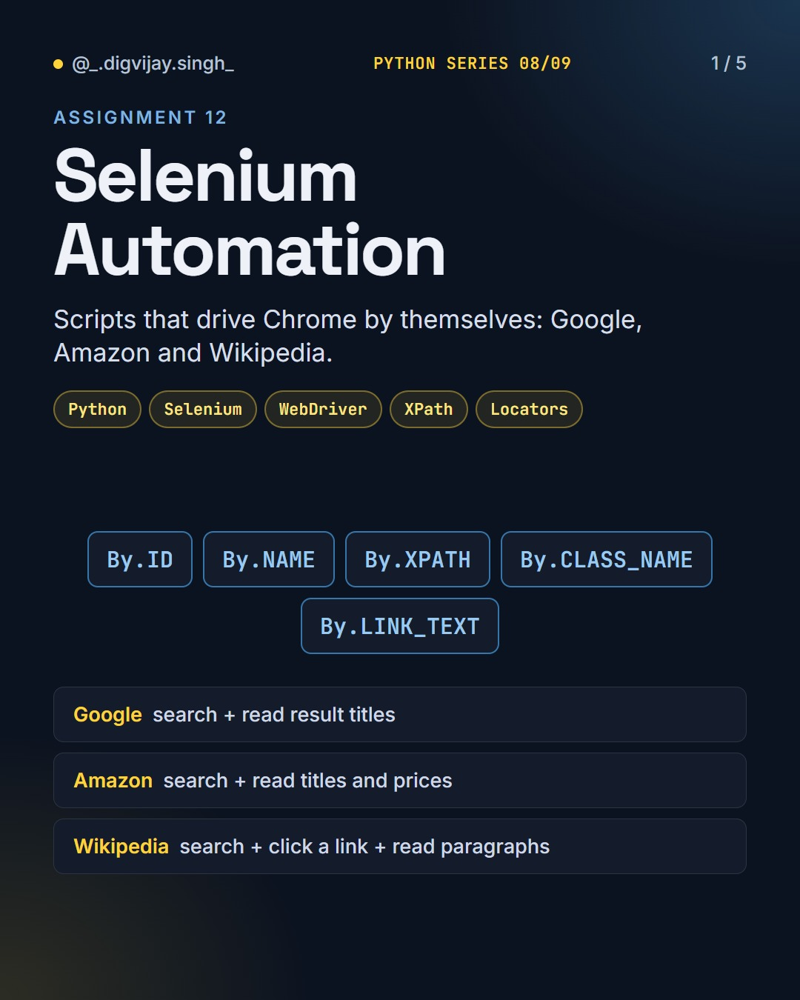
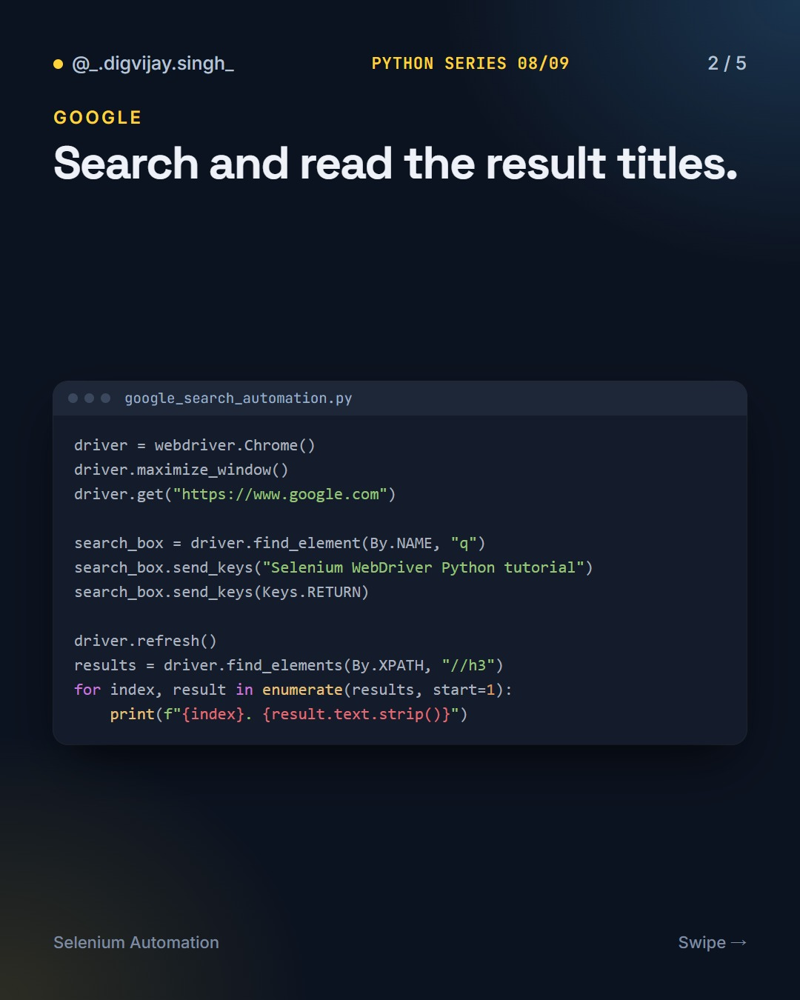
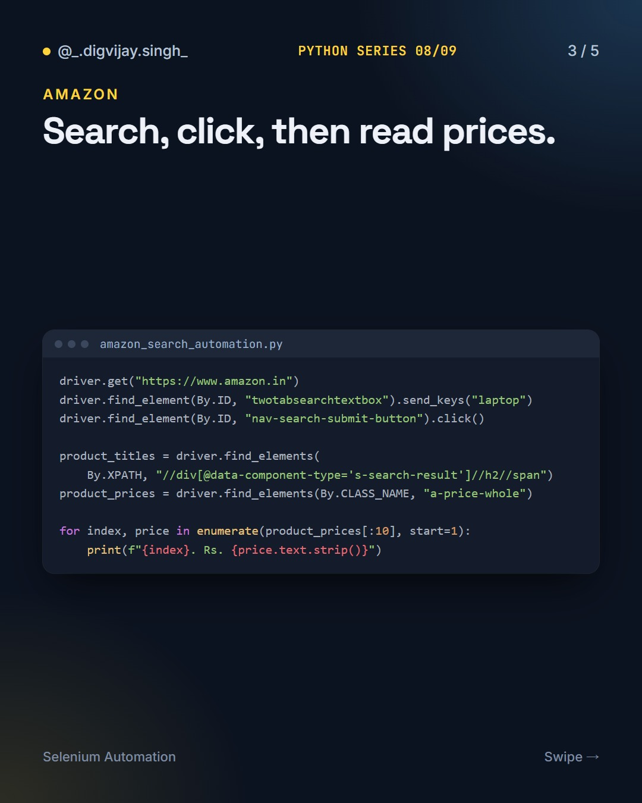
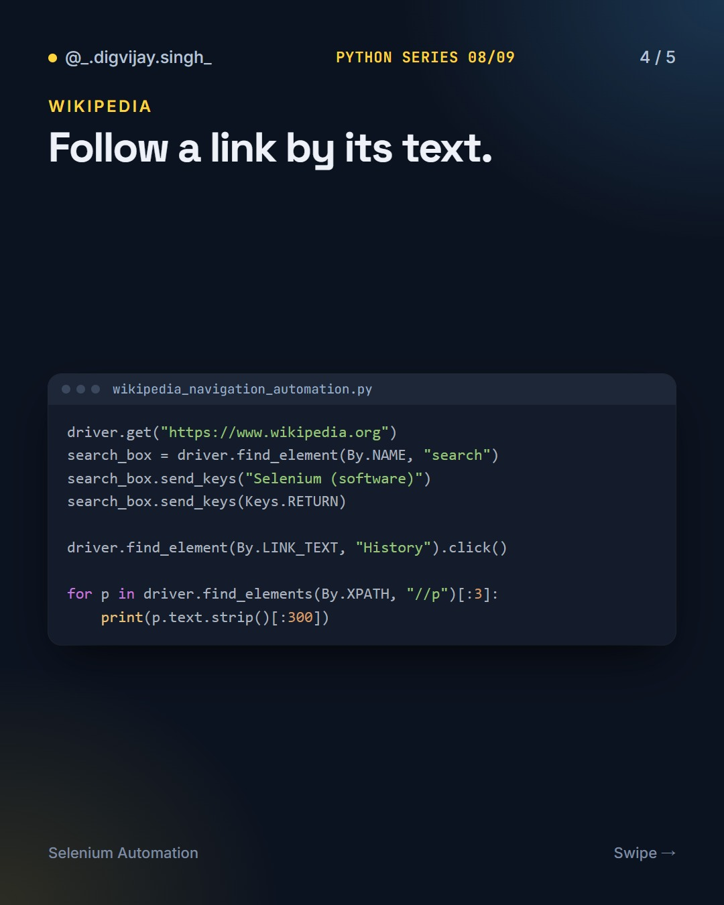
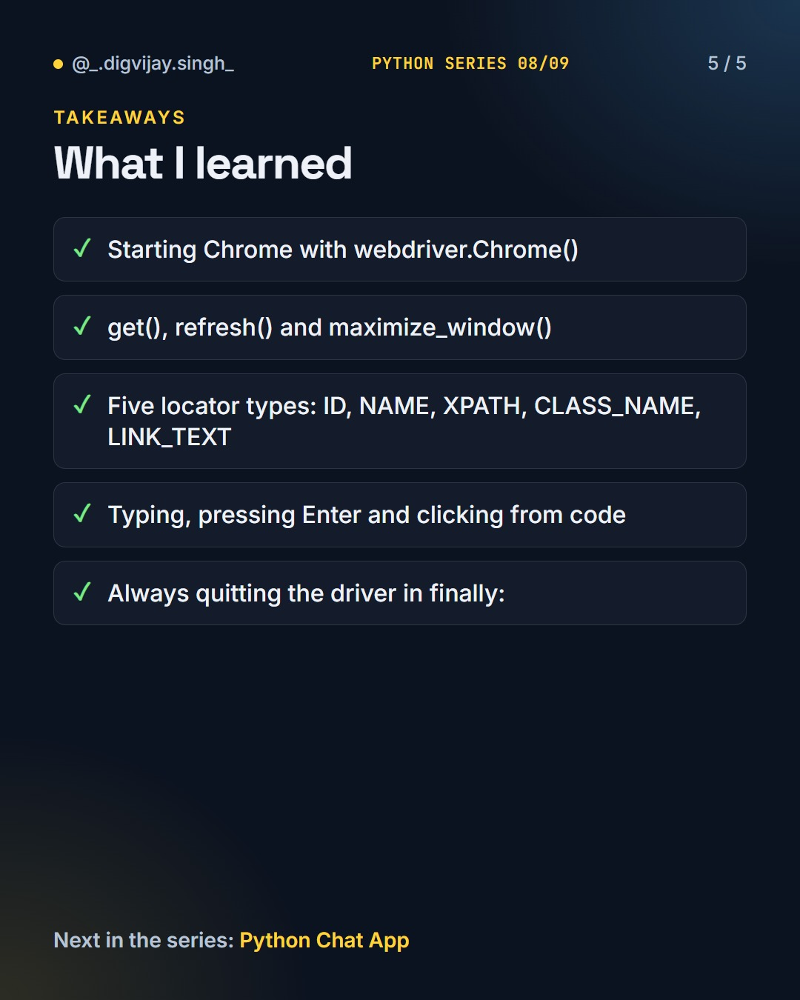

# Selenium Automation

<p align="center"></p>

Three Python scripts that drive Chrome with Selenium: a Google search, an Amazon product search and a Wikipedia article walk.

Part 8 of 9 in my **Python Series**.

## How to run

You need Google Chrome installed.

```bash
pip install -r requirements.txt
python google_search_automation.py
python amazon_search_automation.py
python wikipedia_navigation_automation.py
```

Live sites change their layout often, so a locator may need updating over time.

The original assignment notes are in [NOTES.md](NOTES.md).

## What I learned

- Starting Chrome with `webdriver.Chrome()`
- `get()`, `refresh()` and `maximize_window()`
- Five locator types: `ID`, `NAME`, `XPATH`, `CLASS_NAME`, `LINK_TEXT`
- Typing, pressing Enter and clicking from code
- Always quitting the driver in `finally:`

## Slides

<p>




</p>

## The Python Series

1. [Python Basics](https://github.com/digvijay165/python-basics)
2. [Tkinter Calculator](https://github.com/digvijay165/tkinter-calculator)
3. [Python + PostgreSQL](https://github.com/digvijay165/python-postgresql)
4. [Flask Registration Form](https://github.com/digvijay165/flask-registration-form)
5. [Django REST Blog API](https://github.com/digvijay165/django-rest-blog-api)
6. [Python Web Scraper](https://github.com/digvijay165/python-web-scraper)
7. [OpenCV Practicals](https://github.com/digvijay165/opencv-practicals)
8. **Selenium Automation**
9. [Python Chat App](https://github.com/digvijay165/python-chat-app)
